# Референси каруселей Lightweight

Одне місце для всіх прикладів. Відкрий цей файл на GitHub → олівець Edit → перетягни скриншоти в потрібний розділ → дочекайся завершення завантаження → Commit changes.

**Одна карусель = один розділ REF-XXX. Зображення зверху вниз = порядок її слайдів.**

Для кожної каруселі додавай скриншоти окремою пачкою в її розділ. Між різними каруселями не змішуй зображення. Порядок після вставлення можна переглянути у Preview. Перейменовувати всі файли не потрібно.

Назва, посилання на TikTok і коротке пояснення необов'язкові. За потреби просто напиши «подобається обкладинка» чи «беремо структуру».

Це приклади для аналізу; додавання референсу НЕ затверджує його як стиль Lightweight. Поточний стиль не затверджено.

У REF-001 додано скриншоти першої каруселі. Інші розділи поки порожні. Один додатковий скриншот розміщений на початку файла; його позицію в послідовності ще не визначено.

---

## REF-001 — Карусель 1

Назва або тема:  
Посилання на оригінал:  
Що подобається:  

### Слайди

---

## REF-002 — Карусель 2

Назва або тема:  
Посилання на оригінал:  
Що подобається:  

### Слайди

---

## REF-003 — Карусель 3

Назва або тема:  
Посилання на оригінал:  
Що подобається:  

### Слайди

---

## REF-004 — Карусель 4

Назва або тема:  
Посилання на оригінал:  
Що подобається:  

### Слайди

---

## REF-005 — Карусель 5

Назва або тема:  
Посилання на оригінал:  
Що подобається:  

### Слайди

---
## REF-006 — Карусель 6

Назва або тема:  
Посилання на оригінал:  
Що подобається:  

### Слайди

---

## REF-007 — Карусель 7

Назва або тема:  
Посилання на оригінал:  
Що подобається:  

### Слайди

---

## REF-008 — Chest exercise tier list (Arrow)

Назва або тема: chest tier list (from worst to best)
Посилання на оригінал: Arrow @arrowfitnessapp, TikTok, ~2026-10-16. 19.3K лайків, 86 коментарів, 7045 збережень. Звук: Into You (Slowed) - Altare.alt & Eclipse.
Підпис: «Chest exercise tier list. Do you agree?? #gymtips #tierlist #chestexercise #chestday #hypertrophy»
Що подобається: власник хоче спробувати цей стиль з нашими кольорами (2026-10-19).
Статус: **уся карусель (19 слайдів) записана**; усі 19 файлів у репозиторії (власник надсилає по 5 скриншотів). Файли лежать у репозиторії: `references/images/REF-008/`.

### Слайди (частина 1, порядок від власника)
1. 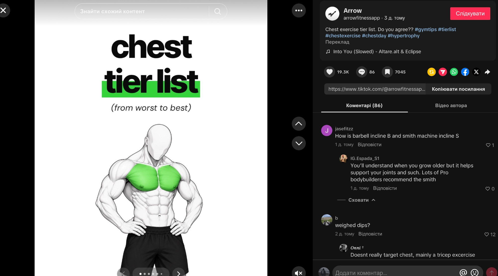 Обкладинка: `chest` / `tier list` (зелена смуга-маркер під `tier list`) / `(from worst to best)` курсивом. Фігура спереду, руки на поясі, груди зелені, чорні шорти.
2. 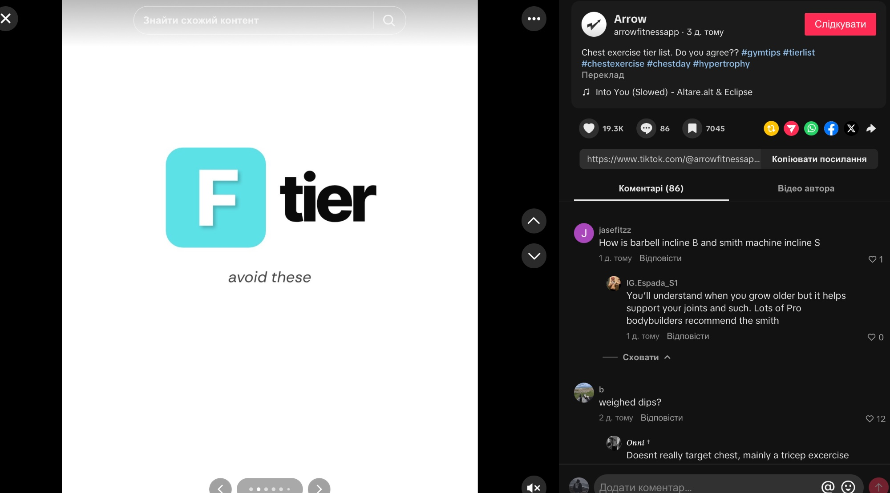 Роздільник: блакитний квадрат `F` + `tier`; курсив `avoid these`.
3. 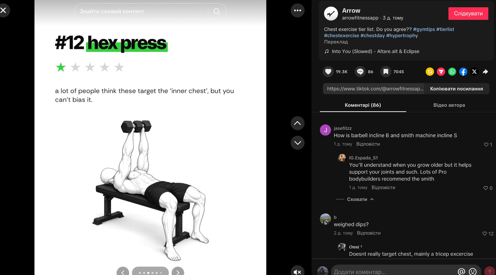 `#12 hex press` (маркер під `hex press`), 1 зірка з 5. Текст: `a lot of people think these target the ‘inner chest’, but you can’t bias it.` Фігура: жим гантелей разом лежачи на рівній лаві.
4. 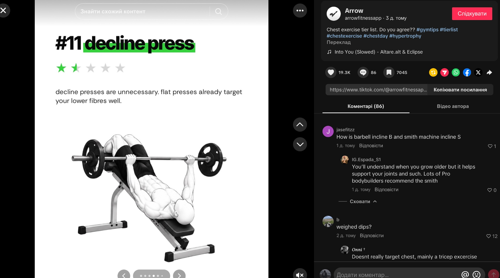 `#11 decline press` (маркер), 1,5 зірки з 5. Текст: `decline presses are unnecessary. flat presses already target your lower fibres well.` Фігура: жим штанги на лаві з від'ємним нахилом.
5. 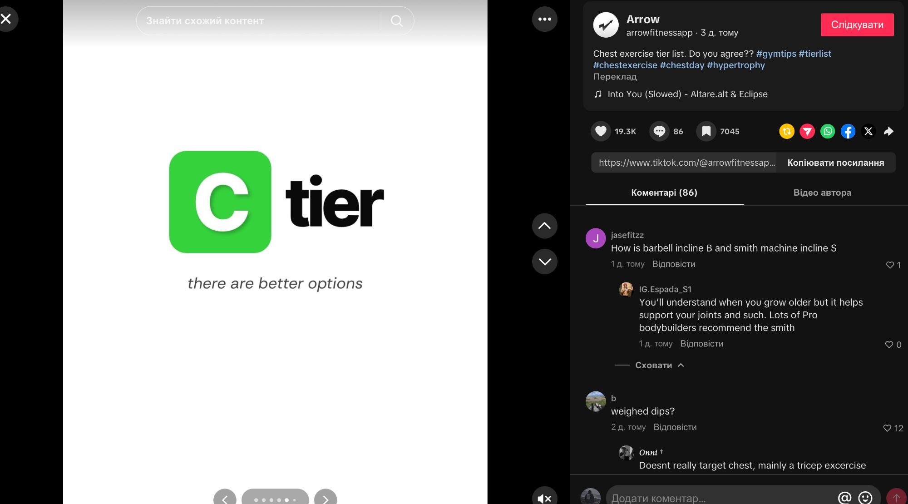 Роздільник: зелений квадрат `C` + `tier`; курсив `there are better options`.

### Слайди (частина 2, порядок від власника)
6. 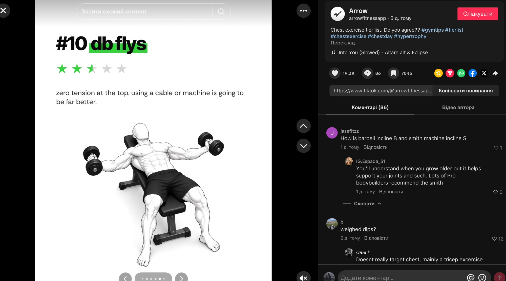 `#10 db flys` (маркер), 2,5 зірки з 5. Текст: `zero tension at the top. using a cable or machine is going to be far better.` Фігура: розведення гантелей лежачи на лаві, руки розведені.
7. 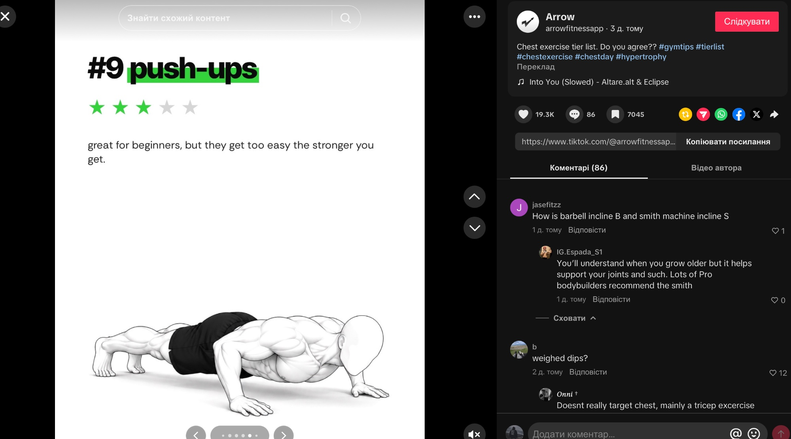 `#9 push-ups` (маркер), 3 зірки з 5. Текст: `great for beginners, but they get too easy the stronger you get.` Фігура: віджимання, вид збоку, внизу слайда.
8. 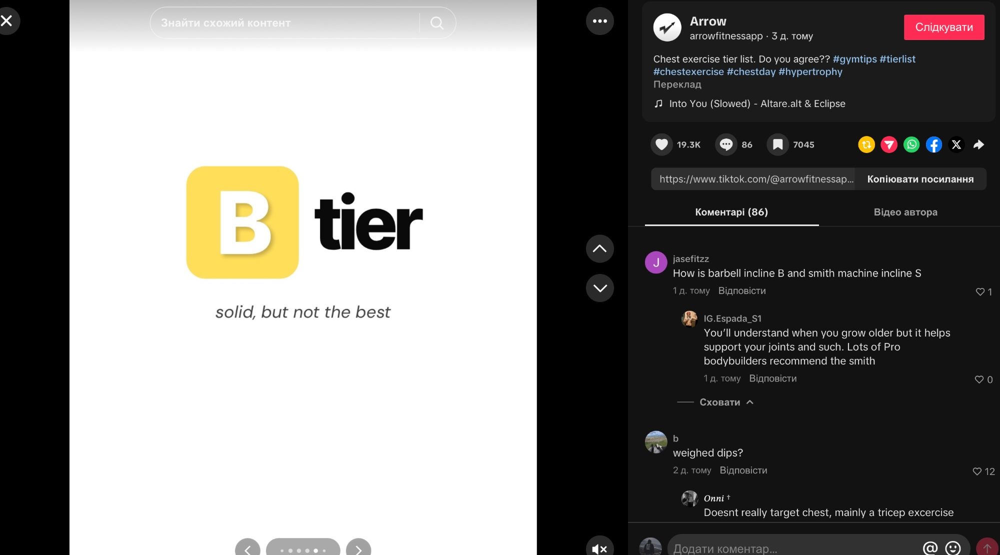 Роздільник: жовтий квадрат `B` + `tier`; курсив `solid, but not the best`.
9. 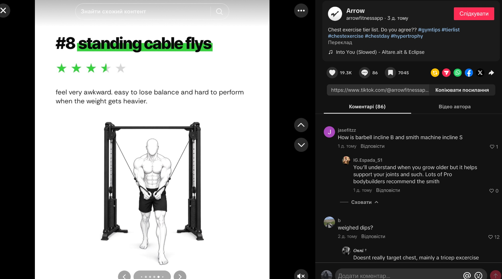 `#8 standing cable flys` (маркер), 3,5 зірки з 5. Текст: `feel very awkward. easy to lose balance and hard to perform when the weight gets heavier.` Фігура: зведення рук у кросовері стоячи, вид спереду, рама кросовера.
10. 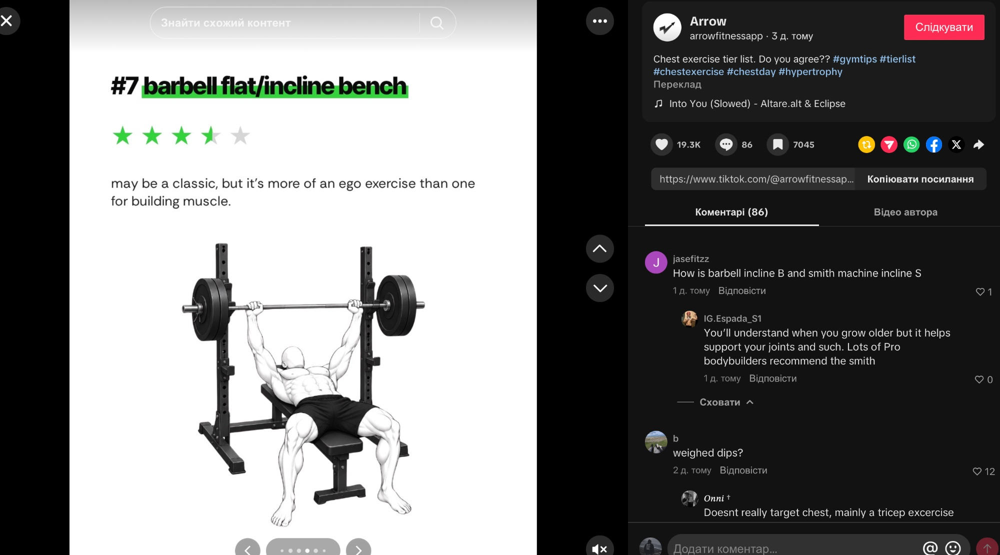 `#7 barbell flat/incline bench` (маркер), 3,5 зірки з 5. Текст: `may be a classic, but it’s more of an ego exercise than one for building muscle.` Фігура: жим штанги лежачи в стійці, вид спереду під кутом.

### Слайди (частина 3, порядок від власника)
11. 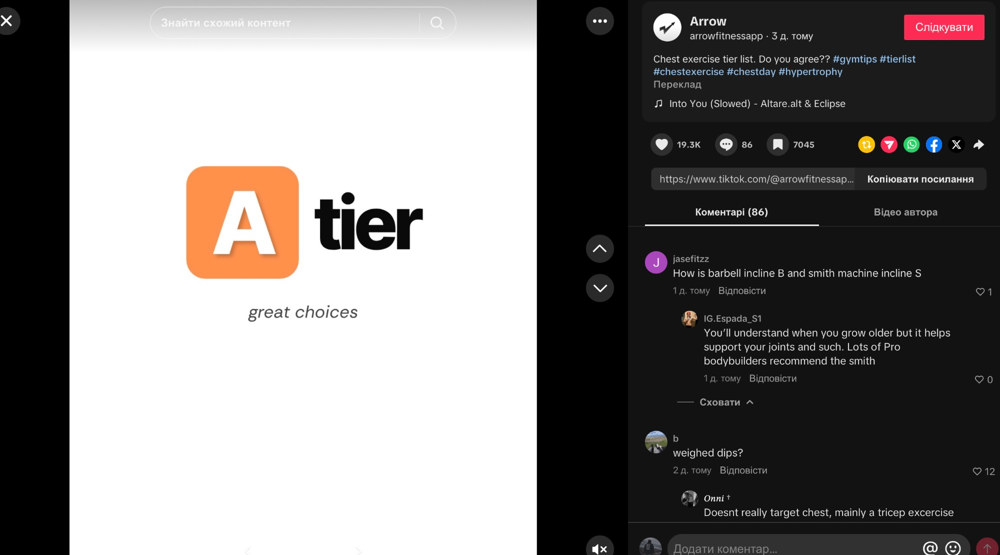 Роздільник: помаранчевий квадрат `A` + `tier`; курсив `great choices`.
12. 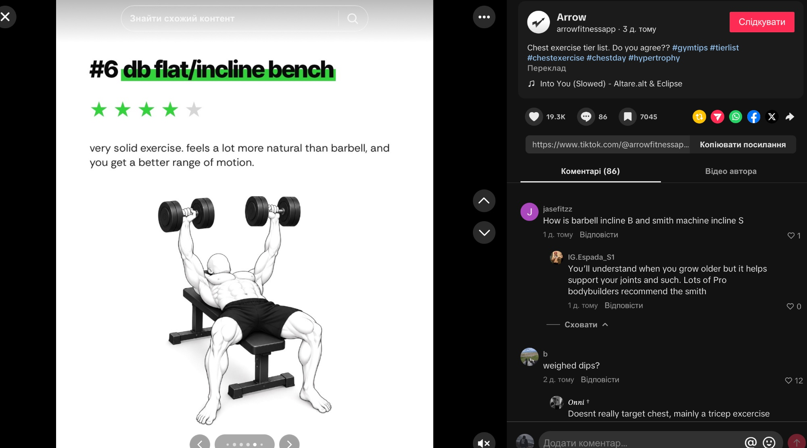 `#6 db flat/incline bench` (маркер), 4 зірки з 5. Текст: `very solid exercise. feels a lot more natural than barbell, and you get a better range of motion.` Фігура: жим гантелей лежачи на лаві, вид спереду.
13. 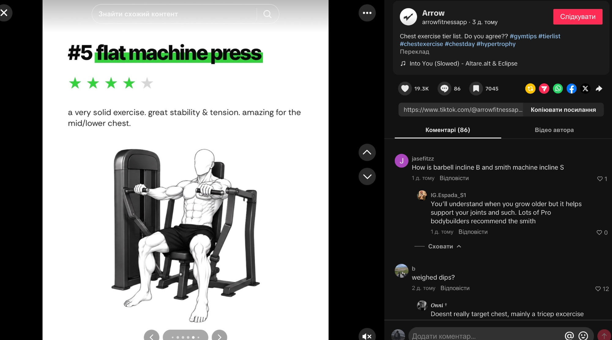 `#5 flat machine press` (маркер), 4 зірки з 5. Текст: `a very solid exercise. great stability & tension. amazing for the mid/lower chest.` Фігура: жим у тренажері сидячи.
14. 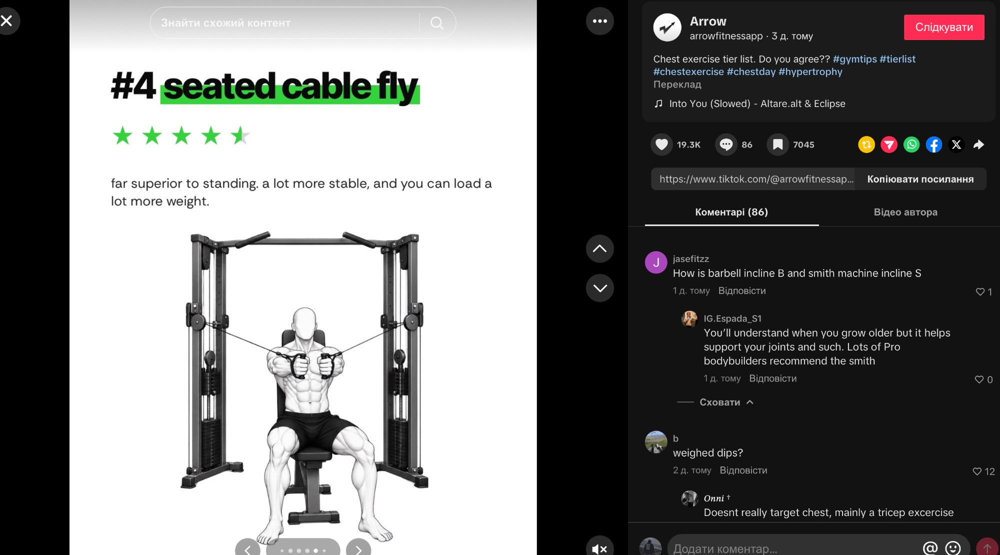 `#4 seated cable fly` (маркер), 4,5 зірки з 5. Текст: `far superior to standing. a lot more stable, and you can load a lot more weight.` Фігура: зведення рук у кросовері сидячи на лаві, вид спереду.
15. 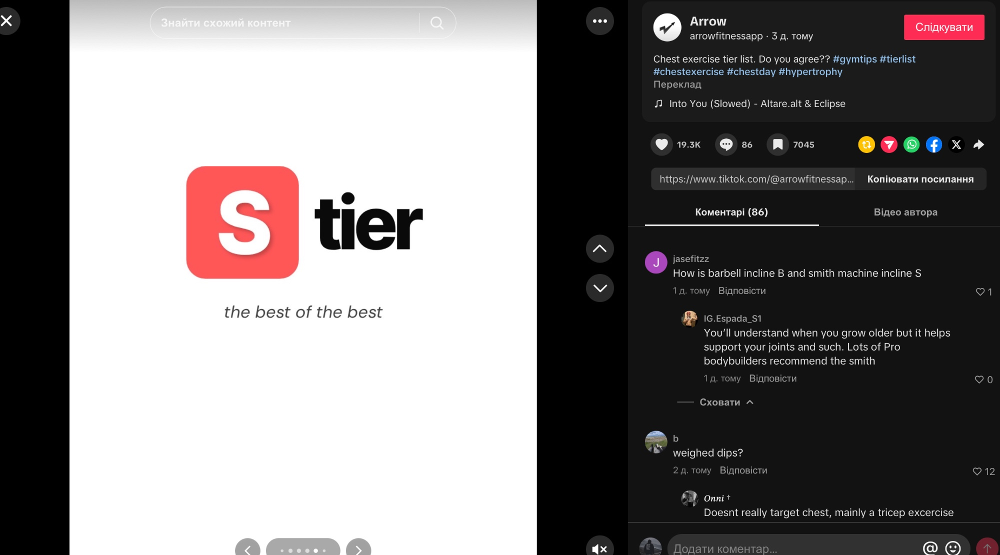 Роздільник: червоний квадрат `S` + `tier`; курсив `the best of the best`.

### Слайди (частина 4, остання, порядок від власника)
16. 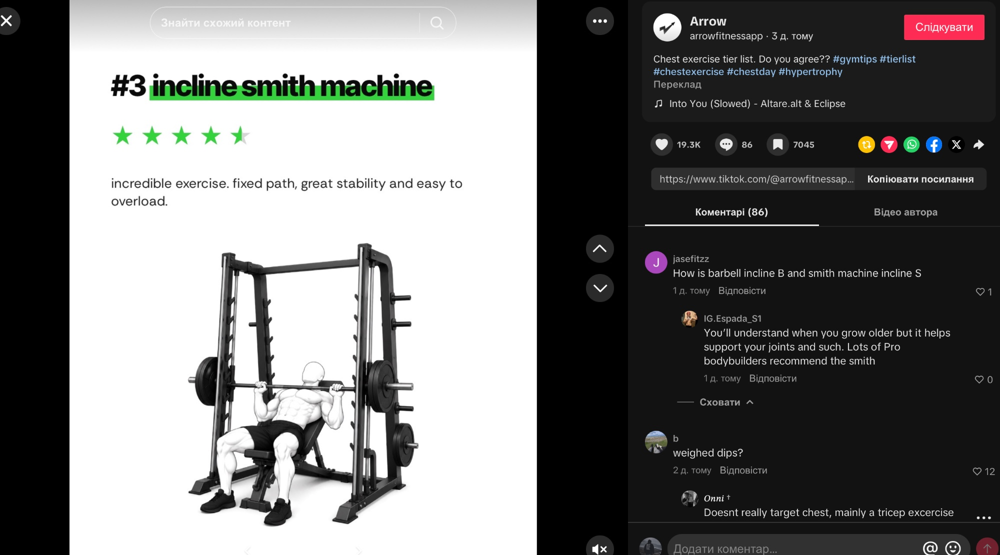 `#3 incline smith machine` (маркер), 4,5 зірки з 5. Текст: `incredible exercise. fixed path, great stability and easy to overload.` Фігура: жим на похилій лаві в машині Сміта.
17. 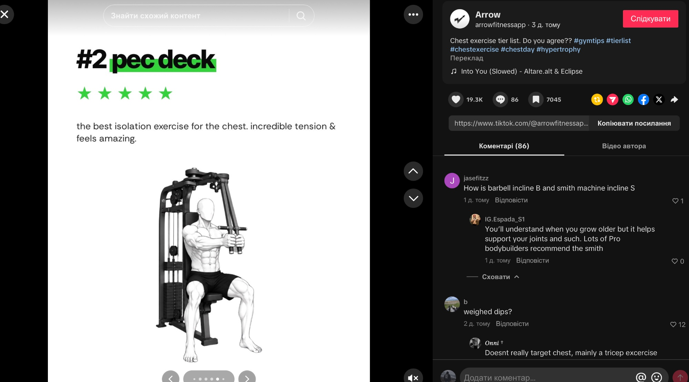 `#2 pec deck` (маркер), 5 зірок з 5. Текст: `the best isolation exercise for the chest. incredible tension & feels amazing.` Фігура: зведення рук у тренажері «батерфляй» сидячи.
18. 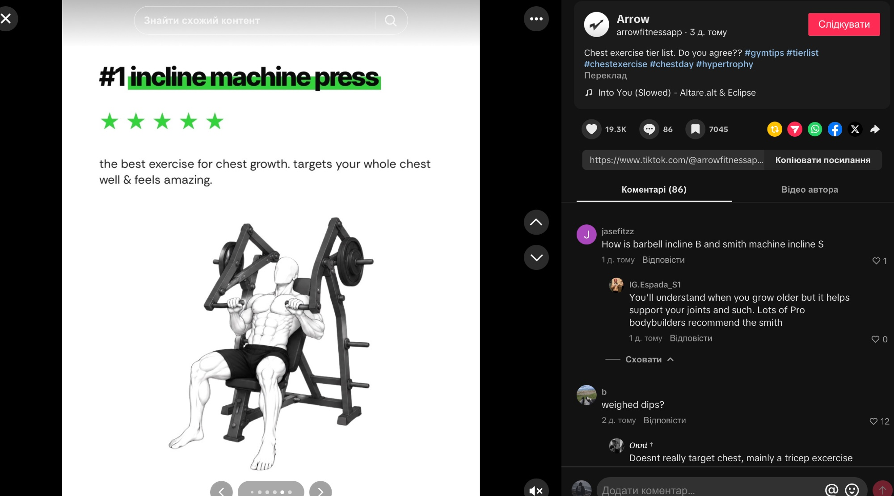 `#1 incline machine press` (маркер), 5 зірок з 5. Текст: `the best exercise for chest growth. targets your whole chest well & feels amazing.` Фігура: жим у похилому важільному тренажері з дисками.
19. 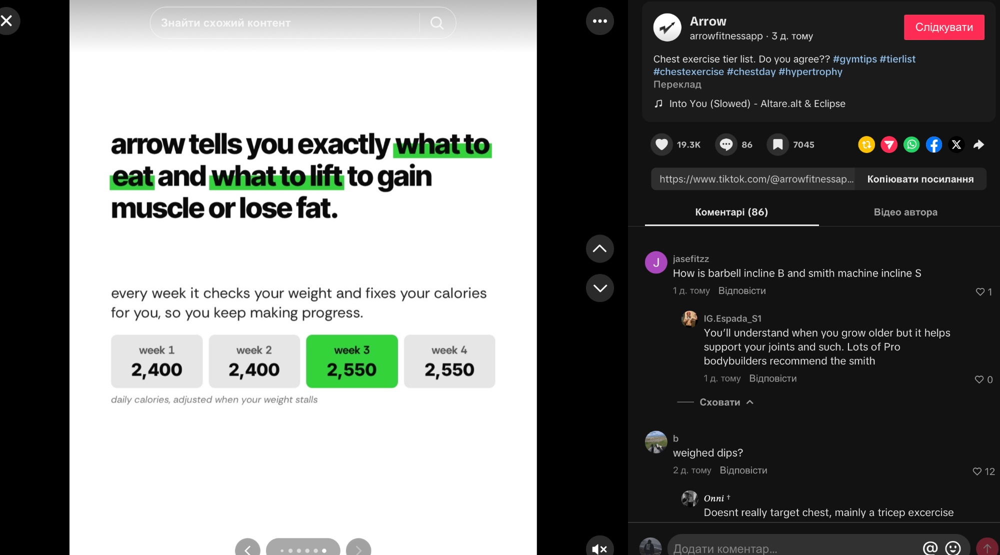 Фінал (продукт Arrow, без телефона): великий жирний текст `arrow tells you exactly what to eat and what to lift to gain muscle or lose fat.` (маркер під `what to eat` і `what to lift`). Під ним: `every week it checks your weight and fixes your calories for you, so you keep making progress.` Чотири картки: `week 1 2,400`, `week 2 2,400`, `week 3 2,550` (зелена), `week 4 2,550`; курсив `daily calories, adjusted when your weight stalls`.

Разом 19 слайдів: обкладинка, 6 роздільників тірів (F, C, B, A, S; D немає), 12 вправ, фінал.

---

<!-- Наступні каруселі додавай новими розділами REF-005, REF-006 тощо, за тим самим зразком. -->

## Правила для агентів

- Читати тільки призначені REF-ID, а не всі зображення на кожному етапі.
- Власник задає межі каруселей розділами; порядок слайдів задає порядок image links у розділі.
- Спочатку перевірити, що потрібні зображення реально доступні для читання. Наявність Markdown-посилання не доводить доступність пікселів у конкретному середовищі.
- Якщо референс не відкривається, назвати точний REF-ID/слайд і блокер. Не вигадувати візуальну відповідність.
- Зафіксувати у завданні REF-ID, commit цього файла, порядок і URL зображень.
- Підготовлений для конкретної каруселі витяг/опис зберігати в її brief, щоб наступний виконавець не перечитував усю колекцію.
- Не переписувати оригінальні підписи, не міняти порядок і не видаляти вкладення без запиту власника.
- Не завантажувати ці зображення на комп'ютер власника. Якщо генератору потрібні файли, використовувати явно обране хмарне середовище.
